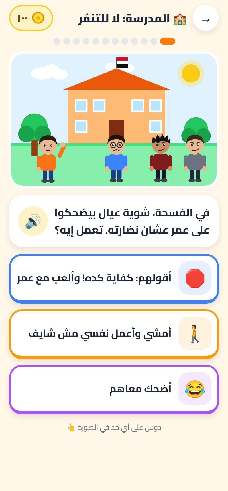

# HeroKid (هيرو كيد)

A mobile game for children around 7 years old, built for Egyptian families. Arabic (Egyptian, simple) first, with an English switch.
The child sees an illustrated situation, picks what to do, and the drawn characters react. Good choices win coins, wrong choices cost more.



## What is in version 1
| Area | Content |
|---|---|
| Worlds | School: No Bullying (12), Home & Family (6), Club & Street (6), Online Safety (6): **30 situations** |
| Coins | Start **100** · right first time **+20** · wrong **−30** · right after a mistake **+15** (so a mistake costs net −15) · daily challenge **+10** extra · never below 0 |
| Play | Drawn scenes (SVG), characters that react (cry / cheer / look ashamed), tap characters to make them jump, confetti, shake, floating coins, sounds, music, phone vibration |
| Read-aloud | Question, answers and feedback are read aloud by the phone's voice (ar-EG / en-US) |
| Rewards | 4 levels (Kind Friend → HeroKid), 9 badges, shop with capes, masks, hats, shirts and pets |
| Daily | One challenge a day with a streak |
| Profiles | Up to 4 children per phone |
| Parents | PIN-locked corner: progress per world, first-try accuracy, the situations the child got wrong with the right answer and a talking tip, settings, reset/delete, Egypt Child Helpline 16000 |
| Privacy | No accounts, no ads, no internet: everything is stored on the phone (AsyncStorage). Microphone permission is removed |

## Run it
```bash
npm install
```
```bash
npx expo start
```
Web preview: `npm run export:web` then serve `dist/`.

## Change content
- Situations and texts: `src/content/scenarios.ts` (Arabic + English in one place).
- Picture for each situation: `src/art/scenes.ts` (background, characters, moods, props) and the answer icons.
- Coin rules, levels, badges, shop prices: `src/game/rules.ts` (`RULES` at the top).
- UI words: `src/i18n.ts`.
- Sounds and icons are generated: `npm run sounds`, `npm run icons`.

## Build the Android app (VPS, signed .aab)
Uses the `androidbuildvps` scripts (Expo prebuild + Docker). Package id: `com.herokid.app`.
```bash
cd /opt/herokid && git pull
```
```bash
PROJECT_DIR=/opt/herokid KEYSTORE=/root/android-keys/upload.jks APP_NAME=HeroKid bash <skill>/scripts/build-aab.sh
```
Prebuild and the release-signing patch were tested against this project.

## Google Play notes (children's app)
- Target audience: under 13. Join the **Families** programme; fill **Data safety** as "no data collected".
- Privacy policy URL is still required, even with no data collected.
- No ads, no in-app purchases (coins are earned only).

## Project layout
```
app/            screens (expo-router): title, profiles, new-profile, home, world/[id], daily, shop, badges, parent
src/art/        drawn characters, backgrounds, props, scene definitions
src/components/ animated scene + play loop
src/content/    the 30 situations (ar/en)
src/game/       rules, levels, badges, shop
docs/           art bible, screenshots
```

## PWA test build
`npm run build:pwa` exports the web app and writes two folders (both git-ignored):
- `dist-pwa/` is an installable, offline-capable PWA (manifest, icons, service worker). Host it at the root of any HTTPS (sub)domain, for example `test.herokid.app/`, with every unknown path falling back to `index.html`.
- `dist-artifact/` is the same game prepared for a Claude Artifact link (no install or offline there).
